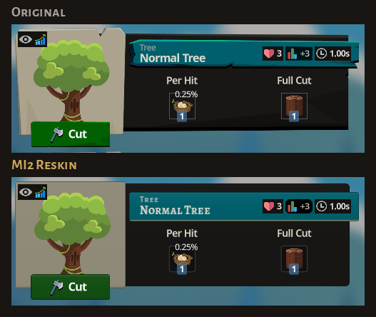
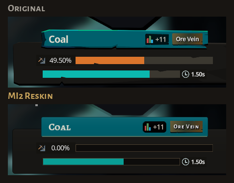
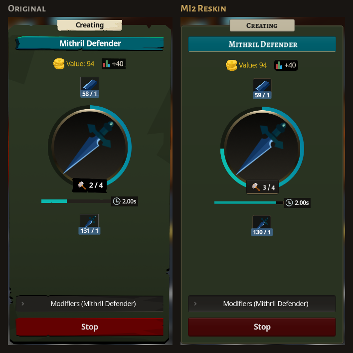
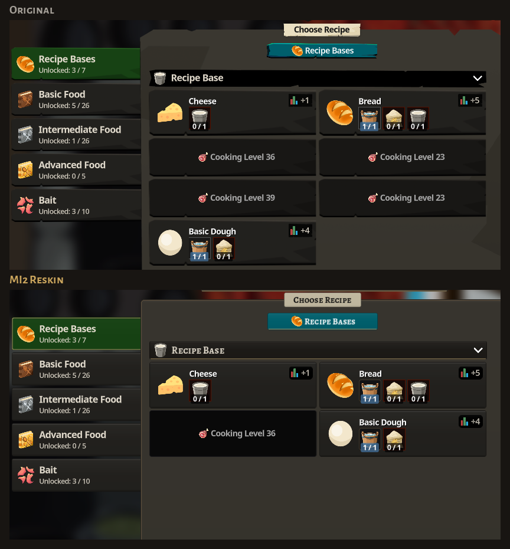
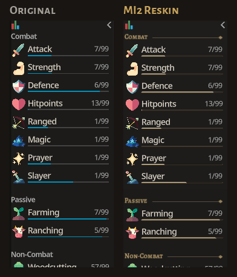
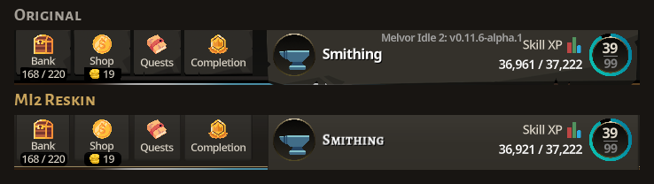

# MI2 Reskin

A free visual overhaul for **Melvor Idle 2**. It redraws the game's blurry, jagged panels as clean, crafted-looking ones in the game's own colours. It also tidies cluttered pages and adds finishing touches such as bronze scrollbars and a sword pointer.

Press **F7** in the game at any time to compare with the original look.

> **Unofficial.** Made by a player, not by Games By Malcs. The download contains no art from the game. It changes how the game draws its own panels, while you play. It doesn't touch the game's files or your saves.

## Before and after

All screenshots are at the game's real size.

**Cards.** The stretched, torn-paper pictures behind cards and headers become clean panels, and titles use a small-caps font.



**Headers and progress bars.** Ragged header strips become straight bars. Progress bars get a dark inset track.



**Frames.** The jagged teal and green frames become even, with a thin bronze edge.



**Tidier pages.** Lists show only the next locked entry instead of every one.



**Sidebar.** Gold headings with a divider, and slim gold level bars.



**Top bar.** Page titles in the title font, and the version text moves out from over the title.



## What you need

- Windows, and **Melvor Idle 2** on Steam (tested on Early Access v0.11.6).
- Optional: **Melvor Idle 1** on Steam, if you want its icons (see [Settings](#settings)).

## Install

1. Download the latest `MI2-Reskin-….zip` from the [Releases page](https://github.com/nchJoJo/mi2-reskin/releases/latest).
2. Unzip it anywhere, for example into your Downloads folder.
3. Close the game.
4. Double-click **`Install.cmd`**. It finds Melvor Idle 2 through Steam by itself and says where it installed.
   If Windows asks whether to run the file, choose **Run**. If it shows "Windows protected your PC", choose **More info → Run anyway**.
5. Start the game.

**To update**, do the same with the new zip. Your settings are kept.

**If the installer can't find the game:** open PowerShell in the unzipped folder and give it the game's folder yourself:

```powershell
.\install.ps1 -Game 'D:\SteamLibrary\steamapps\common\Melvor Idle 2'
```

## Uninstall

Close the game and double-click **`Uninstall.cmd`**. It removes exactly the files the installer added.

Your reskin settings stay in `%APPDATA%\Games By Malcs\Melvor Idle 2\`, in case you install it again. To remove every trace, also delete the `mi2_reskin_*` files there.

## Using it

- **F7** switches the reskin on and off while you play.
- **Settings:** open the game's menu (☰) → **Settings**. Under **Mods**, open the **Reskin** page. Changes apply at once, with no restart. **Reset to defaults** is at the bottom.

## What it changes

**Panels and frame**
- The game's stretched, blurry panel pictures become clean, sharp panels, with the same layout and spacing.
- Each kind of part gets one consistent look:
  - frames with bronze trim;
  - cards with a lit top edge;
  - header bars with a gold underline;
  - bevelled buttons;
  - pressed-in selected items;
  - dimmed locked cards.
- Header and page titles use the Alegreya SC font; small captions use Alegreya Sans SC.
- The version text moves out from over the page title to a small plaque under the top bar.
- The "coming soon" teaser in the top bar is hidden. The footer's groups get hover labels, and the sidebar headings turn gold.

**Pages**
- Lists show only the **next** locked entry, not every locked one.
- The crafting pages' "Creating" column only shows while something is being made.
- Crafting pages and the Shop **reopen the category you used last**, instead of an empty "select a category" view.
- Quests: the empty dialogue column stays hidden until there is dialogue.
- The hard black shadows behind rock, tree and monster pictures become faint.
- Locked text is grey instead of an alarming red, and unlock hints are dimmed.
- The Bank's row of mouse shortcuts moves into a **?** next to the search box.
- Empty strips and boxes (Farming, Bank) stop drawing.
- The Hunting column matches the panel beside it.
- Button text sits centred.
- Items with no picture yet show a small medallion instead of a grey placeholder.

**Polish**
- Progress bars get a dark inset track with a bronze rim.
- Scrollbars are rounded, with a bronze grip.
- The sidebar gets gold level bars and a gold edge on the active skill.
- Pages fade in when they open.
- Item tooltips show the item's name in gold.
- Numbers keep their width as they count, so they don't jiggle.
- The pointer is a small sword.

**Optional Melvor Idle 1 extras** (off by default)
- Melvor Idle 1's skill and item icons, read from your own Melvor Idle 1 install. Nothing is copied or shipped.
- Melvor Idle 1's slate-grey colours.

## Settings

All of these are on the in-game **Reskin** page (Settings → Mods → Reskin).

| Setting | Default | What it does |
|---|---|---|
| **Look** | | |
| Reskin | On | The whole mod. F7 does the same. |
| Panel style | Crafted | **Crafted**: trims, bevels and a look per kind of part. **Flat**: plain panels with a thin rim. |
| Finish | Soft | How much bronze and gold the crafted look uses. **Soft**: calm and low in contrast, for long sessions. **Crafted**: the full look. **Gilded**: extra gold. |
| Title fonts | On | Alegreya fonts for titles and captions. |
| **Frame & Pages** | | |
| Tidy the frame | On | Hides the teaser, labels the footer, gold sidebar headings. |
| Tidy the pages | On | Everything under "Pages" above. |
| Remember categories | On | Crafting pages and the Shop reopen your last category. |
| Picture shadows | Faint | The shadow behind rock, tree and monster pictures: **Off**, **Faint** or the **Game's**. |
| Frame the detail column | Off | A framed panel behind the selected rock's or tree's details. |
| **Polish** | | |
| Crafted progress bars | On | Inset tracks with a bronze rim. |
| Bronze scrollbars | On | Rounded scrollbars with a bronze grip. |
| Sidebar polish | On | Gold level bars and a gold edge on the active skill. |
| Motion | On | Pages fade in. |
| Item tooltips | On | The item's name in gold. |
| Even-width digits | On | Numbers keep their width. |
| Mouse pointer | Sword | **Sword** or the **Normal** pointer. |
| **Melvor Idle 1** | | |
| Melvor Idle 1 icons | Off | Icons from your own Melvor Idle 1 install. |
| Melvor Idle 1 colours | Off | Melvor Idle 1's slate greys. |

### More settings

A few rarer settings are only in the file `mod\mi2_reskin.cfg`, inside the game's folder. Each one is explained in the file. Edit it with Notepad and restart the game. Your choices on the Reskin page still win over this file.

| Setting | Default | What it does |
|---|---|---|
| `toggle_key` | `"F7"` | The on/off key. |
| `panel_radius` | `6` | Corner rounding, in pixels. |
| `panel_opacity` | `1.0` | Below 1, panels let the scenery show through. |
| `title_font_file`, `caption_font_file` | Alegreya | Other fonts from `mod\fonts\`. |
| `[mi1] keep_teal_headers` | off | With Melvor Idle 1 colours, keeps the game's teal header bars. |
| `[mi1] plain_background` | off | With Melvor Idle 1 colours, hides the painted scenery. |
| `[mi1] path` | (found by itself) | Where Melvor Idle 1 is installed, if it isn't found in your Steam libraries. |

## Troubleshooting

- **Nothing changed.** Restart the game after installing. Press F7 in case the reskin was switched off.
- **The installer says `override.cfg` belongs to another mod.** Another mod uses the same way into the game. The installer won't overwrite it; merge the `[autoload]` lines of both files by hand.
- **Something looks wrong after a game update.** Press F7 to get the original look back, or uninstall. The log is at `%APPDATA%\Games By Malcs\Melvor Idle 2\mi2_reskin.log`; please attach it when reporting a problem.

## More

- [How it works](docs/DETAILS.md): what the reskin changes and how, an API for other mods to match its look, and dev mode.

## Licence

The code is under the [MIT licence](LICENSE). The two Alegreya fonts in `mod\fonts\` are under the SIL Open Font License 1.1, with their licences next to them.

## Support

If you enjoy the mod, you can buy me a coffee:

[](https://ko-fi.com/nchjojo)
